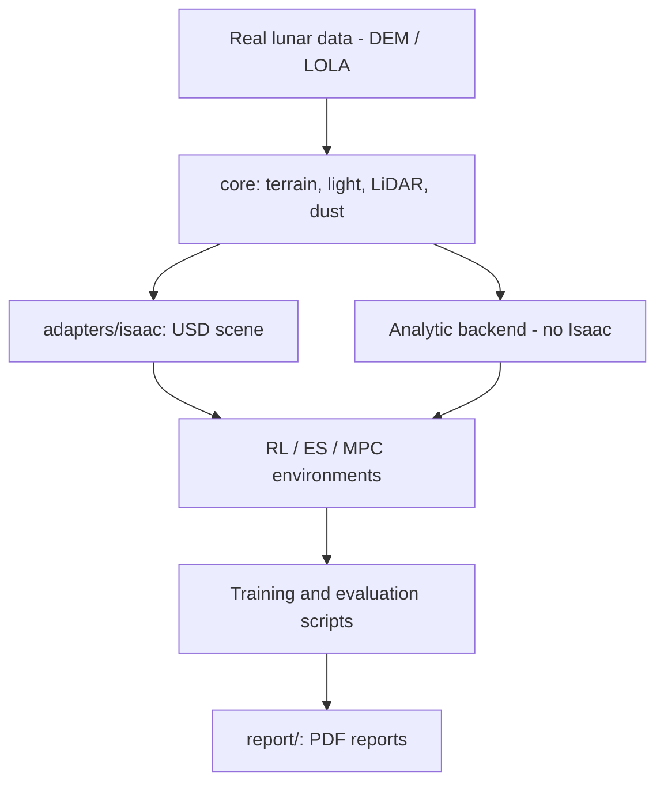

🇬🇧 English · 🇹🇷 [Türkçe](README.tr.md)

# LunarSim

**A reusable lunar terrain, lighting, LiDAR and RL-environment simulation library that can plug into Isaac Sim / Isaac Lab.**

`lunarsim/core` does not depend on Isaac (numpy/scipy/rasterio/skyfield); `lunarsim/adapters/isaac` attaches it to an Isaac Sim USD scene. It produces terrain from real lunar data, sun/shadow, LiDAR ground truth, dust and lander RL environments.


*RL dashboard for the lunar landing task (poster frame).*

## Summary

| | |
|---|---|
| **Problem** | Realistic, repeatable terrain and sensor simulation for lunar landing (especially highlands / hazard avoidance); RL/ES/MPC comparison |
| **Method** | Terrain from real DEM/LOLA data, hazard/criterion analysis; RL (PPO/SAC), evolution strategies (ES), MPC and guided-gain controllers |
| **Simulation / hardware** | Isaac Sim 6.0.1 + Isaac Lab (Docker, NVIDIA GPU); the core also runs without Isaac |
| **Paper** | Reports: [`report/`](report/) (RL, ES, MPC, crater, problem-catalogue PDFs) |

### System architecture


*Difference from area-based detail control (Gaussian ROI).*

`lunarsim/core` (terrain, light, LiDAR, dust) → `lunarsim/adapters/isaac` (USD scene) → `lunarsim/rl`, `lunarsim/evo`, `lunarsim/control` (environments and controllers). Detailed usage: [docs/README_ayrintili.md](docs/README_ayrintili.md) (Turkish).

### Flow diagram (how it works)



The core is independent of Isaac; the same environments run both on the fast analytic backend and in an Isaac scene.

## Selected results

Results and plots are collected in the reports:

- RL landing report: [`report/lunarsim_rl_rapor.pdf`](report/lunarsim_rl_rapor.pdf)
- RL vs ES: [`report/lunarsim_rl_vs_es_rapor.pdf`](report/lunarsim_rl_vs_es_rapor.pdf)
- MPC: [`report/lunarsim_mpc_rapor.pdf`](report/lunarsim_mpc_rapor.pdf)
- Evolutionary search: [`report/lunarsim_evo_rapor.pdf`](report/lunarsim_evo_rapor.pdf)
- Crater comparison: [`report/lunarsim_krater_rapor.pdf`](report/lunarsim_krater_rapor.pdf)


*Map view after landing.*

*TODO: move a numeric summary table (success rate, mean speed) from the reports into the README.*

*All figures are in `report/` and `docs/assets/`.*

## Installation

### Requirements
- Linux, Python 3; for the Isaac part Docker + NVIDIA Container Toolkit + GPU (~25 GB images)

### Steps
```bash
git clone https://github.com/GulogluHaktan/LunarSim.git
cd LunarSim
python3 -m venv .venv
.venv/bin/pip install -e ".[dev]"
.venv/bin/python -m pytest tests/ -v
./scripts/install_isaac_docker.sh      # optional: Isaac Sim / Isaac Lab images
```

## Usage

Commands for core (Isaac-free) terrain/LiDAR/RL generation and Isaac validation: [docs/README_ayrintili.md](docs/README_ayrintili.md) (*Hızlı kullanım*, *Script indeksi*).
Expected output: `pytest` passes; scripts write videos/data under `out/` (git-ignored).

## Reproducing the results

| Output | Command |
|---|---|
| RL report | `python report/build_report.py` |
| RL vs ES report | `python report/build_rl_vs_es_report.py` |
| MPC report | `python report/build_mpc_report.py` |
| Evo report | `python report/build_evo_report.py` |
| Crater report | `python report/build_krater_rapor.py` |

## Project structure

```
LunarSim/
├── lunarsim/
│   ├── core/         # terrain, light, LiDAR, dust (Isaac-free)
│   ├── adapters/     # isaac: USD scene bindings
│   ├── rl/           # RL environments, reward, curriculum
│   ├── evo/          # ES / MPC / policy code
│   └── control/      # classical controllers
├── scripts/          # training, evaluation, recording, report pipeline
├── tests/            # pytest
├── report/           # report builders and PDF outputs
├── docs/ assets/     # documents, README images
└── pyproject.toml
```

## Citation, license, contact

```bibtex
@misc{lunarsim2026,
  title  = {LunarSim: Lunar Terrain and Sensor Simulation for Landing RL},
  author = {Haktan G{\"u}lo{\u{g}}lu},
  year   = {2026},
  url    = {https://github.com/GulogluHaktan/LunarSim}
}
```
License: TODO. Contact: MTA Artificial Intelligence Center, Haktan Güloğlu.
