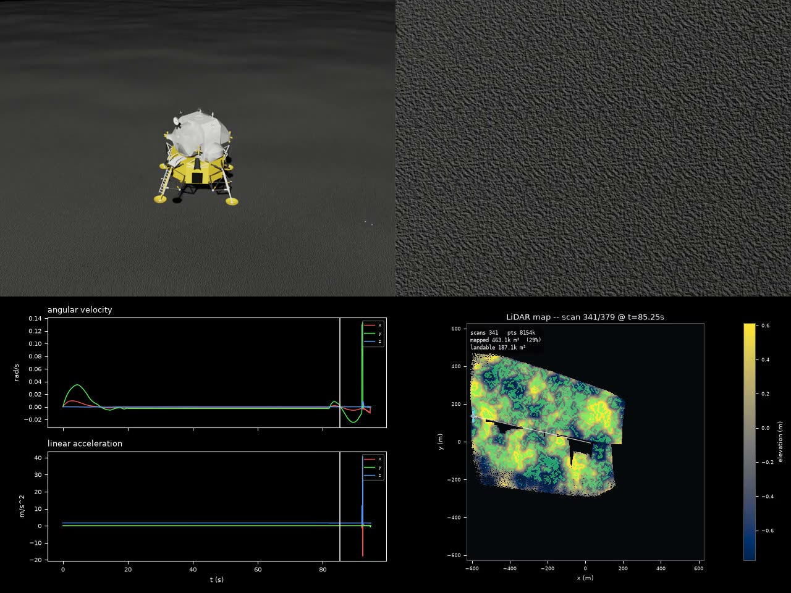
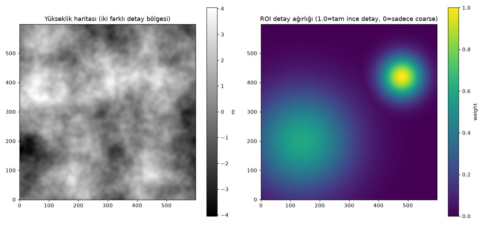
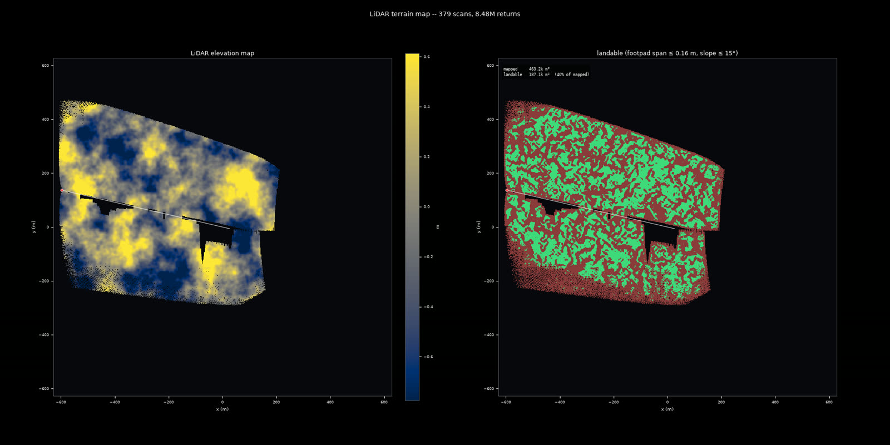

# LunarSim

**Isaac Sim / Isaac Lab'a bağlanabilen, yeniden kullanılabilir Ay arazisi, ışık, LiDAR ve RL ortamı simülasyon kütüphanesi.**

`lunarsim/core` Isaac'e bağımlı değildir (numpy/scipy/rasterio/skyfield); `lunarsim/adapters/isaac` bunu Isaac Sim USD sahnesine bağlar. Gerçek Ay verisiyle arazi, güneş/gölge, LiDAR ground-truth, toz ve iniş (lander) RL ortamları üretir.


*Ay iniş görevi için RL dashboard'u (poster kare).*

## Özet

| | |
|---|---|
| **Problem** | Ay'a iniş (özellikle dağlık bölge / tehlike kaçınma) için gerçekçi, tekrarlanabilir arazi ve sensör simülasyonu; RL/ES/MPC karşılaştırması |
| **Yöntem** | Gerçek DEM/LOLA verisiyle arazi, hazard/kriter analizi; RL (PPO/SAC), evrimsel stratejiler (ES), MPC ve guided-gain kontrolcüleri |
| **Simülasyon / donanım** | Isaac Sim 6.0.1 + Isaac Lab (Docker, NVIDIA GPU); çekirdek Isaac'siz de çalışır |
| **Makale** | Raporlar: [`report/`](report/) (RL, ES, MPC, krater, problem kataloğu PDF'leri) |

### Sistem mimarisi


*Alan-bazlı detay kontrolü (Gaussian ROI) farkı.*

`lunarsim/core` (arazi, ışık, LiDAR, toz) → `lunarsim/adapters/isaac` (USD sahne) → `lunarsim/rl`, `lunarsim/evo`, `lunarsim/control` (ortamlar ve kontrolcüler). Ayrıntılı kullanım: [docs/README_ayrintili.md](docs/README_ayrintili.md).

## Seçilmiş sonuçlar

Sonuçlar ve grafikler raporlarda toplanmıştır:

- RL iniş raporu: [`report/lunarsim_rl_rapor.pdf`](report/lunarsim_rl_rapor.pdf)
- RL vs ES: [`report/lunarsim_rl_vs_es_rapor.pdf`](report/lunarsim_rl_vs_es_rapor.pdf)
- MPC: [`report/lunarsim_mpc_rapor.pdf`](report/lunarsim_mpc_rapor.pdf)
- Evrimsel arama: [`report/lunarsim_evo_rapor.pdf`](report/lunarsim_evo_rapor.pdf)
- Krater karşılaştırması: [`report/lunarsim_krater_rapor.pdf`](report/lunarsim_krater_rapor.pdf)


*İniş sonrası harita görünümü.*

*TODO: README'ye sayısal özet tablosu (başarı oranı, ortalama hız) raporlardan taşınacak.*

*Tüm şekiller `report/` ve `docs/assets/` klasöründe.*

## Kurulum

### Gereksinimler
- Linux, Python 3; Isaac kısmı için Docker + NVIDIA Container Toolkit + GPU (~25 GB imaj)

### Adımlar
```bash
git clone https://github.com/GulogluHaktan/LunarSim.git
cd LunarSim
python3 -m venv .venv
.venv/bin/pip install -e ".[dev]"
.venv/bin/python -m pytest tests/ -v
./scripts/install_isaac_docker.sh      # opsiyonel: Isaac Sim / Isaac Lab imajları
```

## Kullanım

Çekirdek (Isaac'siz) arazi/LiDAR/RL üretimi ve Isaac doğrulaması için komutlar: [docs/README_ayrintili.md](docs/README_ayrintili.md) (*Hızlı kullanım*, *Script indeksi*).
Beklenen çıktı: `pytest` testlerinin geçmesi; betikler `out/` altına video/veri üretir (git dışı).

## Sonuçları yeniden üret

| Çıktı | Komut |
|---|---|
| RL raporu | `python report/build_report.py` |
| RL vs ES raporu | `python report/build_rl_vs_es_report.py` |
| MPC raporu | `python report/build_mpc_report.py` |
| Evo raporu | `python report/build_evo_report.py` |
| Krater raporu | `python report/build_krater_rapor.py` |

## Proje yapısı

```
LunarSim/
├── lunarsim/
│   ├── core/         # arazi, ışık, LiDAR, toz (Isaac'siz)
│   ├── adapters/     # isaac: USD sahne bağlayıcıları
│   ├── rl/           # RL ortamları, ödül, curriculum
│   ├── evo/          # ES / MPC / politika kodları
│   └── control/      # klasik kontrolcüler
├── scripts/          # eğitim, değerlendirme, kayıt, rapor hattı
├── tests/            # pytest
├── report/           # rapor üreticileri ve PDF çıktıları
├── docs/ assets/     # dokümanlar, README görselleri
└── pyproject.toml
```

## Atıf, lisans, iletişim

```bibtex
@misc{lunarsim2026,
  title  = {LunarSim: Lunar Terrain and Sensor Simulation for Landing RL},
  author = {Haktan G{\"u}lo{\u{g}}lu},
  year   = {2026},
  url    = {https://github.com/GulogluHaktan/LunarSim}
}
```
Lisans: TODO. İletişim: MTA Yapay Zeka Merkezi, Haktan Güloğlu.
